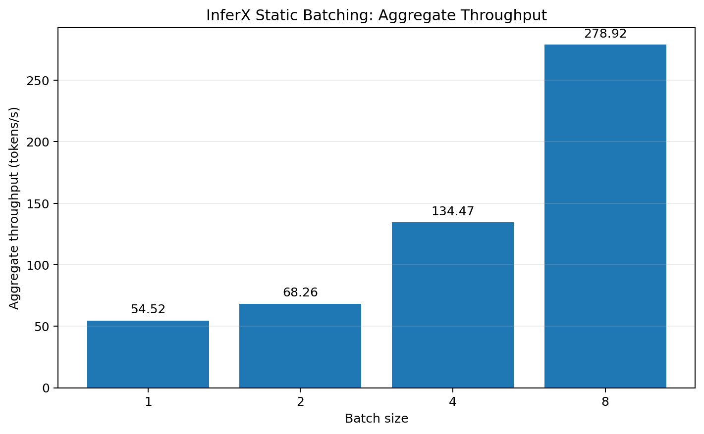
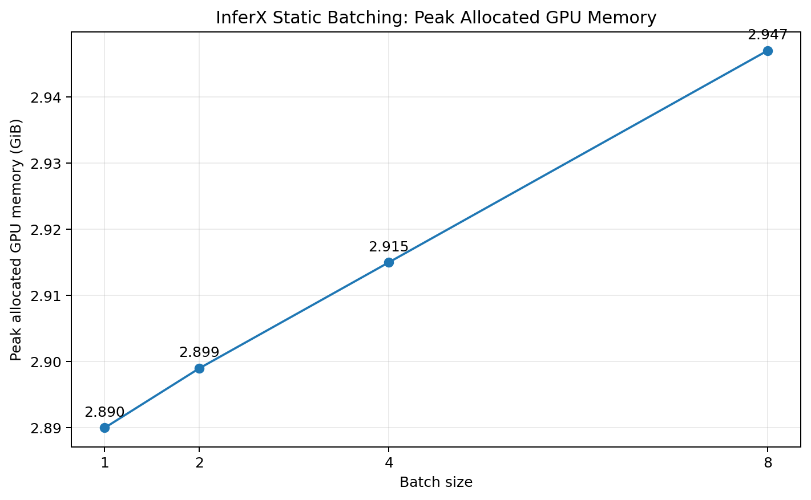

## Static Batching Benchmark

### Environment and configuration

- **Model:** Qwen2.5-1.5B-Instruct (loaded from the local model directory)
- **GPU:** NVIDIA A100 80GB PCIe
- **Precision:** BF16
- **Generation:** Greedy decoding (`do_sample=False`)
- **Maximum new tokens:** 128
- **Warm-up runs:** 2
- **Measured runs:** 5 per batch size
- **Requests per measured run:** 24
- **Batch sizes:** 1, 2, 4, and 8
- **Measurement scope:** Generation time after tokenization and input transfer to the GPU; model loading is excluded.

### Results

Mean aggregate throughput is calculated per run as total generated tokens divided by total generation time across all batches. Values below are averages across the five measured runs.

| Batch size | Mean aggregate throughput (tokens/s) | Mean generation time per 24 requests (s) | Peak allocated GPU memory (GiB) |
|---:|---:|---:|---:|
| 1 | 54.52 | 44.90 | 2.890 |
| 2 | 68.26 | 34.34 | 2.899 |
| 4 | 134.47 | 17.49 | 2.915 |
| 8 | 278.92 | 8.78 | 2.947 |



*Figure: Mean aggregate throughput across five runs. Higher batch sizes improve total throughput for this workload.*



*Figure: Peak allocated GPU memory remains approximately 2.89–2.95 GiB across the tested batch sizes.*

### Interpretation

- Batch size 2 achieved approximately **1.25×** the throughput of batch size 1.
- Batch size 4 achieved approximately **2.47×** the throughput of batch size 1.
- Batch size 8 achieved approximately **5.12×** the throughput of batch size 1.
- Peak allocated GPU memory increased only modestly, from approximately **2.89 GiB** at batch size 1 to **2.95 GiB** at batch size 8.
- These results indicate that static batching improves aggregate generation throughput for this model and workload. Batch latency is not the same as individual request response latency.

### Measurement caveats

- The workload repeats the three available prompts cyclically to create 24 requests per run.
- Total generated-token counts differed between batch sizes in this run. Therefore, validate per-request outputs and EOS handling before treating the throughput results as final or making broad performance claims.
- These measurements represent static, pre-grouped batches. They do not measure online request scheduling, time-to-first-token (TTFT), or production serving latency.
- Results are specific to the model, GPU, precision, prompt set, generation settings, and software environment used here.

### Reproducing the benchmark

From the project root, with a valid GPU allocation and the `inferx` environment active:

```bash
export HF_HUB_OFFLINE=1
export TRANSFORMERS_OFFLINE=1

python -m py_compile scripts/benchmark_batch.py

python scripts/benchmark_batch.py \
  --config configs/bf16.json \
  --batch-sizes 1 2 4 8 \
  --requests-per-run 24
```

Raw benchmark CSV files are saved under `results/raw/`.
